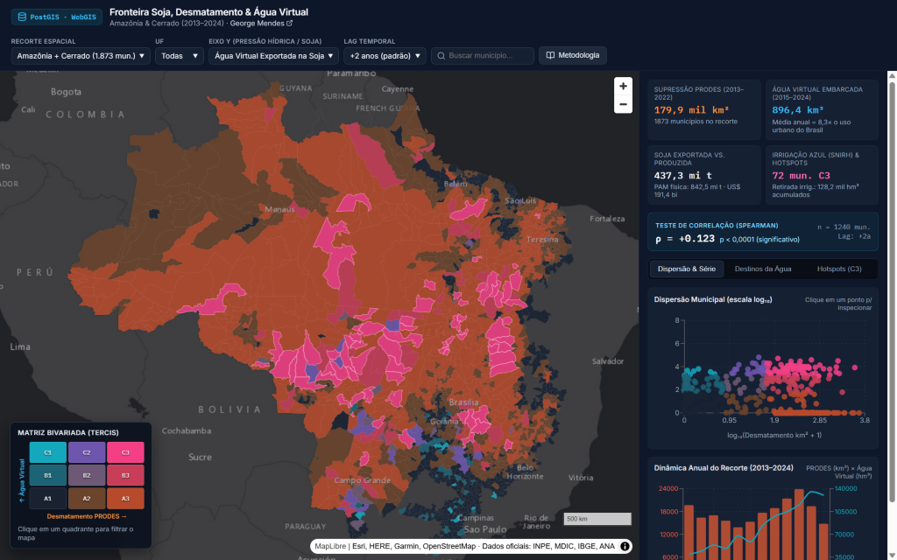
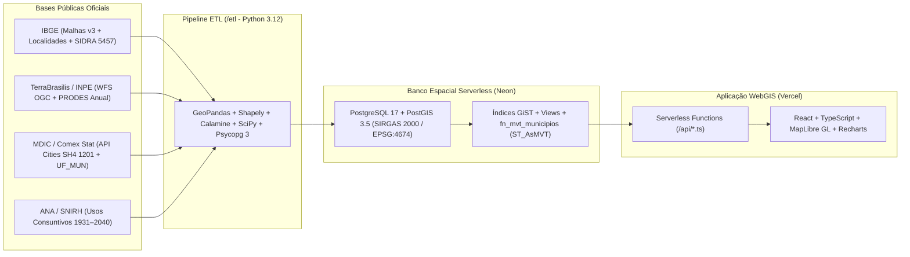

# Fronteira Soja, Desmatamento & Água Virtual — WebGIS Analítico

Plataforma WebGIS de ponta a ponta desenvolvida para investigar espacialmente e estatisticamente o acoplamento entre **supressão de vegetação nativa (PRODES/INPE)**, **expansão agroexportadora de soja (Comex Stat / PAM-IBGE)** e **pressão sobre recursos hídricos — irrigação agrícola e exportação de água virtual (SNIRH/ANA)** nos **1.873 municípios** dos biomas **Amazônia e Cerrado** (`2013–2024`).




---

## 1. Tese e Rigor Metodológico

O avanço da fronteira agrícola brasileira envolve uma dimensão frequentemente invisível nas estatísticas comerciais: além da conversão direta de áreas de Cerrado e Floresta Amazônica, o embarque internacional de milhões de toneladas de grãos representa uma **transferência maciça de água virtual** (*virtual water trade*), somada à intensificação local da **agricultura irrigada por pivôs centrais** (*água azul*) em bacias estratégicas como o Oeste da Bahia (Aquífero Urucuia / Bacia do São Francisco).

Para testar essa hipótese sem distorções analíticas, o pipeline ETL trata três particularidades críticas das bases públicas brasileiras:

1. **Domicílio Fiscal (Comex Stat) vs. Produção Física (PAM/IBGE):**
   As exportações municipais do MDIC (SH4 `1201`) registram o *domicílio fiscal da empresa remetente*, concentrando parte do volume em sedes de *tradings* e polos logísticos. Por isso, o modelo pareia o dado fiscal com a **área plantada e produção física municipal da PAM/IBGE (SIDRA Tabela 5457)** — revelando empiricamente que a correlação de Spearman com o desmatamento salta de $\rho = +0,11$ ($p = 1,2 \times 10^{-4}$) no registro fiscal para **$\rho = +0,33$ ($p < 10^{-31}$)** na produção física municipal.
2. **Água Azul (SNIRH/ANA) vs. Água Virtual Embarcada:**
   Diferencia a captação física para irrigação nos corpos hídricos municipais (*Manual de Usos Consuntivos da Água no Brasil — ANA*, em $\text{m}^3/\text{s}$ e $\text{hm}^3/\text{ano}$) da pegada hídrica total embutida na soja exportada (~$2.050\text{ m}^3/\text{t}$, segundo Hoekstra & Mekonnen), rastreando inclusive os **países compradores** desse volume hídrico virtual.
3. **Ecótonos Amazônia–Cerrado e Defasagem Temporal (*Lag*):**
   Integra as frentes **PRODES Amazônia (Floresta e Não-Floresta)** e **PRODES Cerrado** por código IBGE (`cd_mun`), permitindo avaliar defasagens temporais de `0` a `+3 anos` entre o desmatamento no ano $t$ e a consolidação produtiva/exportadora em $t + k$.

---

## 2. Arquitetura do Sistema



---

## 3. Estrutura do Repositório

```text
fronteira-soja-agua-webgis/
├── api/                        # Endpoints Serverless (Vercel) conectados ao PostGIS
│   ├── _db.ts                  # Conexão Neon Serverless + cálculo estatístico Spearman
│   ├── geometries.ts           # Malha vetorial simplificada via ST_AsGeoJSON
│   ├── mvt.ts                  # Servidor nativo de Vector Tiles (.pbf) via ST_AsMVT
│   ├── map-summary.ts          # Agregação dinâmica com lag temporal e tercis 3x3
│   └── municipality.ts         # Série histórica 2013–2024 e países destino por cd_mun
├── etl/                        # Engenharia de Dados Espaciais em Python
│   ├── extract/                # Conectores oficiais (ibge.py, terrabrasilis.py, comexstat.py, snirh_ana.py)
│   ├── load/                   # Inicialização DDL e carga transacional via PostgreSQL COPY
│   └── run_pipeline.py         # Orquestrador completo reprodutível
├── sql/                        # Scripts SQL / PostGIS
│   ├── 01_schema_postgis.sql   # Tabelas dimensão/fato e índices espaciais GiST
│   └── 02_views_and_functions.sql # Views consolidadas e geração de Vector Tiles MVT
└── src/                        # Interface WebGIS (MapLibre GL JS + matriz bivariada 3x3 + gráficos)
```

---

## 4. Como Reproduzir Localmente

### Pré-requisitos
- **Python 3.12+** e **Node.js 20+**
- Banco **PostgreSQL 16+ com PostGIS** (ex.: instância gratuita no [Neon](https://neon.tech))

### 1. Configurar variáveis de ambiente
Copie `.env.example` para `.env` e informe sua `DATABASE_URL`:

```bash
cp .env.example .env
```

### 2. Executar o Pipeline ETL Geoespacial
```bash
python -m venv .venv
.venv\Scripts\pip install -r etl/requirements.txt
.venv\Scripts\python etl/run_pipeline.py
```

### 3. Iniciar o WebGIS e a API local
```bash
npm install
npm run dev
```

---

## Autor

**George Mendes** — Engenheiro Ambiental e Sanitarista · Especialista em Geotecnologias e Desenvolvimento WebGIS  
Portfólio: [georgemendes.net](https://georgemendes.net/) · LinkedIn: [in/gemendesc](https://www.linkedin.com/in/gemendesc)
